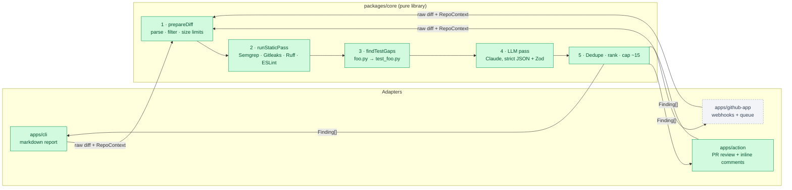
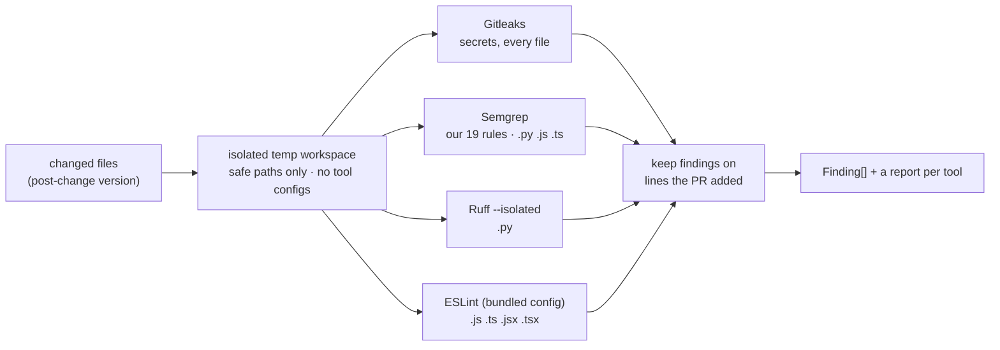

# PR Mentor

An AI code-review assistant for student repositories. It reviews pull requests for
**security issues**, **missing tests** and **code quality**, and every comment is written to
teach: why the issue matters, a small fix, and a link to learn more. The tone is a helpful
senior developer, not a linter.

> **Status:** Milestones 1–5 of 6 are done: diff handling, static analysis, the
> missing-tests check, the Claude pass, the `pr-mentor` CLI, the eval harness and the GitHub
> Action. Next: a GitHub App (M6). See the [roadmap](#roadmap).

## What a review comment looks like

> **🔴 Critical · Security: SQL query built with string formatting** (`app/routes.py:12`)
>
> This query glues `user_id` straight into the SQL text. If someone sends `1 OR 1=1` as their
> ID, the database runs their SQL instead of yours and could return every user's data.
> Parameterised queries keep data and code separate:
>
> ```python
> cursor.execute("SELECT * FROM users WHERE id = ?", (user_id,))
> ```
>
> Learn more: [OWASP: SQL Injection](https://owasp.org/www-community/attacks/SQL_Injection)

## Architecture

The core engine is a pure library: a diff and some repo context go in, a list of structured
findings comes out. It knows nothing about GitHub. Thin adapters (CLI, GitHub Action,
GitHub App) feed it diffs and publish the results.



Green boxes are built; grey dashed boxes are planned. Adapters supply a `RepoContext`
(`readFile(path)` and optionally `listFiles()`) so core can read the post-change code without
knowing whether it comes from a working tree, a checkout, the GitHub API or eval fixtures.

### Step 1: `prepareDiff`

- **Parse** git or plain unified diffs into files and hunks, with old/new line numbers for
  every line. Hunks are read by the counts in their `@@` header, so content such as a removed
  SQL comment (`--- note`) can never be mistaken for a file header.
- **Filter** out what a student didn't write or can't act on: lockfiles, generated files
  (minified bundles, `dist/`, protobuf output, files marked `@generated`), vendored code
  (`vendor/`, `node_modules/`, virtualenvs), binaries and deleted files. Each skipped file
  keeps a reason so the report can say what was left out.
- **Size limits**, counted after filtering: 100 files, 3,000 changed lines and 5 MB of raw
  input by default. Over the limit, the review is skipped with a friendly message suggesting
  smaller PRs.

### Step 2: `runStaticPass`

Cheap, deterministic checks run before the LLM sees anything.



| Tool     | What it catches                                                                                                                                                                        | How it runs                                                                                                     |
| -------- | -------------------------------------------------------------------------------------------------------------------------------------------------------------------------------------- | --------------------------------------------------------------------------------------------------------------- |
| Gitleaks | Hardcoded keys, tokens and passwords (including committed `.env` files)                                                                                                                | `gitleaks dir` on the workspace; the raw secret never leaves the parser                                         |
| Semgrep  | [Our own rules](packages/core/rules/semgrep): SQL/command injection, `eval`, unsafe deserialization, XSS, Flask debug, TLS off, weak password hashes, JWT secrets, routes without auth | `--metrics=off`, local rules only, so results don't change between runs                                         |
| Ruff     | Bugs (undefined names), bandit security checks, swallowed exceptions, mutable defaults, giant/complex functions, dead code                                                             | `--isolated` and `--ignore-noqa`: a repo's config or `# noqa` can't silence it                                  |
| ESLint   | `eval`, empty `catch` blocks, unused variables, unreachable code, complexity, long functions, `==`                                                                                     | Node API with **our** config; the student's `eslint.config.js` is never loaded (it would be running their code) |

- Every common rule comes with a short teaching explanation, a fix snippet and a link
  (OWASP or the tool's docs).
- Tools run in parallel with a per-tool timeout. A missing tool is **skipped with an install
  hint**, a crashing one is reported as **failed**, and neither stops the others.
- Only findings on **lines the PR added** are kept: we review the change, not code that was
  already there, and GitHub can only comment on lines in the diff.

### Step 3: `findTestGaps`

Flags source files that gain new functions (or a meaningful chunk of code) in a PR with no
matching test change.

- A source file is matched to its tests across folders and naming styles: `payments.py` ↔
  `tests/test_payments.py`, `price.ts` ↔ `__tests__/price.test.ts`, `Price.java` ↔
  `PriceTest.java`, `user-service.ts` ↔ `userService.test.ts`.
- It also counts as covered when any changed test mentions one of the new functions.
- Docs, config, migrations, type declarations and trivial edits (comments, imports, a couple
  of lines) are ignored.
- The comment names the new functions, says which edge cases to try, points at an existing
  test file if there is one, and suggests a pytest or `describe`/`it` skeleton.

### Step 4: the Claude pass (`runLlmPass`)

Claude (`claude-sonnet-5-5` by default) reads the diff and the static findings, confirms or
rejects each finding with a reason, adds what the tools missed, and writes a short
encouraging summary.

- **Prompt:** a fixed system prompt (cached between reviews) plus the diff in a block tagged
  `untrusted-diff-<hash of its content>`, so diff text can't close it. Every line carries its
  new-side line number. The prompt says plainly that instructions inside the diff must never
  be followed.
- **Secrets never leave your machine:** the diff is run through the static pass's `redact()`
  first, which hides everything Gitleaks found plus well-known key formats.
- **Strict JSON:** structured outputs (`output_config.format`, built from a Zod schema), then
  validated again on our side. Findings must point at a file and line the diff shows; links
  must be on an allowlist of docs sites; `@mentions`, raw HTML and images are neutralised.
- **Budget and failures:** the prompt is token-counted first and the least important files
  are left out if it's over `PR_MENTOR_MAX_INPUT_TOKENS`. A cut-off answer is retried once at
  lower effort, an invalid one once as is. Refusals use Anthropic's server-side fallback.
  Without credentials, or if anything fails, you still get the static review, and the report
  says why Claude's part is missing.

### Step 5: merge and rank

Claude's confirmations improve the tool findings (better explanation, severity, +0.1
confidence); rejections are dropped and listed with Claude's reason. Overlapping findings
(same file, category and lines) collapse into the best one. Findings are sorted by severity,
then security > tests > quality, then confidence, and only the top 15 are shown; the rest
are listed under a collapsed "more findings" section.

### The `Finding` schema

Every finding, whatever produced it, is validated against one Zod schema
([`finding.ts`](packages/core/src/finding.ts)):

| Field                       | Type                                                        |
| --------------------------- | ----------------------------------------------------------- |
| `file`, `line`, `endLine?`  | repo path; 1-based line numbers on the new side of the diff |
| `category`                  | `security` · `tests` · `quality`                            |
| `severity`                  | `critical` · `high` · `medium` · `low`                      |
| `title`                     | short summary, at most 120 characters                       |
| `explanation`, `suggestion` | why it matters (for a student) and a small fix (Markdown)   |
| `references`                | `{ title, url }[]`, **https only**                          |
| `confidence`                | 0 to 1                                                      |
| `source`                    | `semgrep` · `gitleaks` · `lint` · `heuristic` · `llm`       |
| `ruleId?`                   | the rule behind it, e.g. `ruff/S608`, for dedupe            |

## Setup

You need [pnpm](https://pnpm.io) 12 or newer. `pnpm install` downloads the pinned Node 22
runtime for this project (via `devEngines`), so your system Node version doesn't matter.

```sh
git clone https://github.com/Aswin-Times/Revolver-.git pr-mentor
cd pr-mentor
pnpm install
pnpm test
```

### Static analysis tools (optional, recommended)

ESLint is bundled. Semgrep, Gitleaks and Ruff are external programs; each one is skipped
with a hint if it isn't installed.

```sh
uv tool install ruff          # or: pip install ruff
uv tool install semgrep       # or: pipx install semgrep
brew install gitleaks         # Windows: winget install Gitleaks.Gitleaks
```

`uv` puts tools in `~/.local/bin`; run `uv tool update-shell` once if that folder isn't on
your `PATH`. CI pins Ruff 0.17.6, Semgrep 1.186.0 and Gitleaks 8.30.1.

### Claude API key

The Claude pass needs an Anthropic API key in `ANTHROPIC_API_KEY` (or a profile from
`ant auth login`). Without one, PR Mentor still runs the static checks and says so in the
report. Keys come only from the environment: copy `.env.example` to a file outside the repo
you're reviewing and pass it with `--env-file`. PR Mentor never loads a `.env` on its own,
because a student's `.env` could point `ANTHROPIC_BASE_URL` somewhere else and capture
your key.

## Usage

Build once, then run the CLI inside the repository you want to review:

```sh
pnpm build
pnpm pr-mentor review --base main               # this branch vs main (git diff main...HEAD)
pnpm pr-mentor review --diff pr.diff --repo .   # a saved diff, e.g. from `gh pr diff 42`
pnpm pr-mentor review --base main --no-llm      # static checks only, free
pnpm pr-mentor review --base main --format json --out review.json --fail-on high
```

| Option                           | Default                       | What it does                                           |
| -------------------------------- | ----------------------------- | ------------------------------------------------------ |
| `--base <ref>` / `--diff <file>` | (one required)                | what to review                                         |
| `--repo <dir>`                   | current directory             | where file contents are read from                      |
| `--format markdown\|json`        | `markdown`                    | report format                                          |
| `--out <file>`                   | stdout                        | write the report to a file                             |
| `--no-llm`                       | off                           | skip Claude                                            |
| `--model`, `--effort`            | `claude-sonnet-5-5`, `medium` | Claude model and thinking effort                       |
| `--max-comments <n>`             | 15                            | findings shown                                         |
| `--fail-on <severity>`           | off                           | exit 1 if any finding is at least this severe          |
| `--env-file <file>`              | none                          | read `ANTHROPIC_API_KEY` and `PR_MENTOR_*` from a file |

The same settings can come from `PR_MENTOR_MODEL`, `PR_MENTOR_EFFORT`,
`PR_MENTOR_MAX_COMMENTS`, `PR_MENTOR_MIN_CONFIDENCE`, `PR_MENTOR_MAX_INPUT_TOKENS` and
`PR_MENTOR_MAX_OUTPUT_TOKENS`. Each run prints one line to stderr with the model, tokens,
cost and time. A typical student PR costs about $0.03–0.10.

From code, `reviewDiff(rawDiff, repo, options)` in `@pr-mentor/core` does the whole review
and returns ranked findings plus a report for every tool and for Claude.

## GitHub Action

Add PR Mentor to a student repository by copying
[`examples/student-workflow.yml`](examples/student-workflow.yml) to
`.github/workflows/pr-mentor.yml`:

```yaml
on:
  pull_request:
    types: [opened, synchronize, reopened]
permissions:
  contents: read
  pull-requests: write
jobs:
  review:
    runs-on: ubuntu-latest
    steps:
      - uses: actions/checkout@v7
        with:
          fetch-depth: 0
          ref: ${{ github.event.pull_request.head.sha }}
      - uses: Aswin-Times/Revolver-@main
        with:
          anthropic-api-key: ${{ secrets.ANTHROPIC_API_KEY }} # optional
```

On every push to a PR it:

- posts **inline comments** on the lines that need attention, in one review;
- keeps **one summary comment** (the full report) up to date instead of adding new ones;
- **never repeats a comment**: each one carries a hidden fingerprint of the issue and the code
  it points at (not the line number), so pushing again, or adding lines above, doesn't
  re-post it;
- writes the report to the **job summary**, and sets the `findings` and `cost-usd` outputs.

| Input               | Default                       | What it does                                                  |
| ------------------- | ----------------------------- | ------------------------------------------------------------- |
| `anthropic-api-key` | empty                         | enables the Claude pass; without it the review is static-only |
| `model`, `effort`   | `claude-sonnet-5-5`, `medium` | Claude model and thinking effort                              |
| `max-comments`      | 15                            | findings shown                                                |
| `fail-on`           | empty                         | fail the check if a finding is at least this severe           |
| `github-token`      | `github.token`                | needs `pull-requests: write`                                  |

It's a composite action: it installs the pinned Semgrep, Ruff and Gitleaks and builds PR Mentor
on the runner, which adds about a minute to the job. It uses `on: pull_request` only. For PRs
from forks, GitHub gives a read-only token and no secrets, so the review goes to the job
summary instead of comments. `pull_request_target` is refused on purpose: it would run
with write access and secrets alongside untrusted code.

This repository reviews its own pull requests the same way
([`.github/workflows/pr-mentor.yml`](.github/workflows/pr-mentor.yml)).

## Project layout

```
packages/core/            review engine (pure library, no GitHub code)
  src/finding.ts          Finding schema
  src/redact.ts           secret redaction for anything we display
  src/repo.ts             RepoContext: how adapters supply file contents
  src/diff/               parser, filters, prepareDiff
  src/static/             command runner, workspace, one wrapper per tool, runStaticPass
  src/test-gap/           file classification, new-function detection, findTestGaps
  src/llm/                schema, prompt, Anthropic client, token budget, validation, runLlmPass
  src/review/             merge, rank, reviewDiff (the whole pipeline)
  src/sanitize.ts         makes model text safe for PR comments
  rules/semgrep/          our Semgrep rules (*.yml) with annotated test cases next to them
  test/                   Vitest suites; fixtures are real git/tool output (sanitized)
apps/cli/                 pr-mentor review: git/diff input, markdown/json report
evals/                    fixture PRs, matching, metrics, runner, reports (pnpm eval)
apps/action/              GitHub Action adapter: fingerprints, review planning, Octokit client
action.yml                composite action definition (installs tools, builds, runs apps/action)
scripts/install-tools.sh  pinned Semgrep / Ruff / checksum-verified Gitleaks (CI + Action)
examples/                 copy-paste workflow for student repos
```

## Safety principles

- **Student code is never executed.** All analysis is static. Tools run on a copy of the
  changed files in a temp folder, never on the student's checkout, and the student's tool
  configs (including executable ESLint configs) are never loaded.
- **The diff is untrusted input.** File paths from it are validated before anything is
  written (no `..`, absolute paths or drive letters), tools are started without a shell, the diff
  goes to Claude in a delimited block it can't escape, and Claude's answer is validated and
  sanitized before use. Claude gets no tools, so nothing in a diff can make it call tools or
  fetch URLs.
- **Secrets are redacted** in anything we output: only a known prefix and the last 4
  characters are shown (`sk-ant-****wxyz`, `AKIA****MPLE`), and only when at least 12
  characters stay hidden.
- **Reviews are idempotent:** a new push never re-posts comments that already exist.
- **Costs are capped** with a per-PR token budget, and tokens and cost are logged per review.

## Evaluation

`evals/` holds 16 small fixture PRs, each with the findings a good reviewer should report:

- **Security (6):** Flask SQL injection, hardcoded AWS key, `eval()` on request data, an
  Express `DELETE` route with no auth, `exec` with a template string, pickle on a cookie.
- **Tests (2):** new Python and TypeScript code with no tests.
- **Quality (3):** a 300-line function, swallowed exceptions, dead code and `==`.
- **Mixed (1):** SQL injection, a swallowed error and no tests in one PR.
- **Clean (4):** PRs that should get no comments, including safe parameterised SQL that looks
  risky at a glance.

Each case is a folder with `before/` and `after/` trees, a `case.yaml` with the expected
findings (file, line range, category, why) and "allowed" extras, and a `pr.diff` generated by
real git (`pnpm eval:fixtures`). A finding counts when it has the expected file and category
and its lines are within 2 of the expected range; a second report of the same issue counts as
a false positive, because the student sees it twice.

```sh
pnpm eval                          # static mode: tools + missing-tests check (free)
pnpm eval --mode full --reps 3     # with Claude; prints the cost, stops at --max-cost (default $5)
pnpm eval --compare evals/runs/<earlier run>/report.json
pnpm eval --mode oracle            # harness self-check: must score 100%
```

Runs are saved under `evals/runs/` (results, errors, JSON and markdown report). Claude
failures and answers served by an unexpected model are listed as errors, never scored as
misses; refusals are counted on their own. CI runs the oracle check and the static eval and
fails if precision or recall drops below `evals/thresholds.json`.

**Static baseline** ([full report](evals/reports/baseline-static.md)):

| Category | Precision | Recall |
| -------- | --------- | ------ |
| security | 100%      | 100%   |
| tests    | 100%      | 100%   |
| quality  | 100%      | 100%   |

All 4 clean PRs get zero findings. (The first baseline had 88% security precision: Ruff and
Semgrep reported the same SQL injection a line apart in `mixed-orders`. Ranking now merges the
same kind of issue within two lines, and the eval confirmed the fix.) Two caveats: the cases were written alongside the tools, so the
static numbers are optimistic and the set needs harder cases that only a careful reviewer would
catch; and the labels are human-written by the author, so a second reviewer should spot-check
them. A Claude (`full` mode) baseline is still to come.

## Development

```sh
pnpm test               # everything
pnpm test:unit          # fast unit tests (~2s); pnpm test:watch runs these on save
pnpm test:integration   # runs the real Semgrep, Gitleaks and Ruff (skipped if missing)
PR_MENTOR_LIVE=1 pnpm test:integration   # plus one real Claude review (~$0.05)
pnpm lint               # type-aware ESLint
pnpm typecheck
pnpm format             # Prettier
pnpm build
```

The core engine is built test-first, and each step is mutation-checked: we break the code on
purpose to make sure a test notices. CI installs the pinned tools and runs the integration
tests with `PR_MENTOR_REQUIRE_TOOLS=1`, so they can't be skipped there.

## Roadmap

- [x] **M1:** monorepo scaffold, finding schema, diff parser, filters and size limits
- [x] **M2:** static pass wrappers (Semgrep, Gitleaks, Ruff, ESLint) and the test-gap heuristic
- [x] **M3:** LLM pass with schema validation and retries; CLI markdown report
- [x] **M4:** eval harness with 16 fixture PRs and precision/recall per category (Claude baseline pending)
- [x] **M5:** GitHub Action with inline comments, summary and idempotency
- [ ] **M6:** GitHub App (webhooks, queue, Render deploy) and per-repo `.prmentor.yml`
