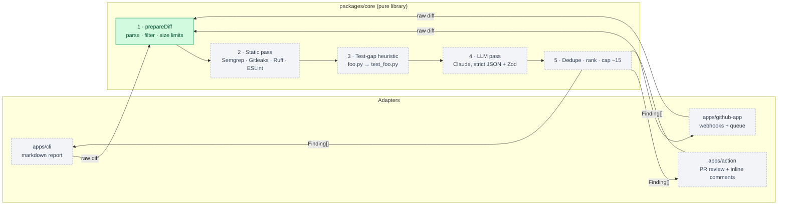

# PR Mentor

An AI code-review assistant for student repositories. It reviews pull requests for
**security issues**, **missing tests** and **code quality**, and every comment is written to
teach: why the issue matters, a small fix, and a link to learn more. The tone is a helpful
senior developer, not a linter.

> **Status:** Milestone 1 of 6 is done (core diff handling). The CLI arrives in Milestone 3.
> See the [roadmap](#roadmap).

## What a review comment looks like

> **🔴 Critical · Security: SQL query built with string formatting** (`app/routes.py:12`)
>
> This query glues `user_id` straight into the SQL text. If someone sends `1 OR 1=1` as their
> ID, the database runs their SQL instead of yours and could return every user's data.
> Parameterised queries keep data and code separate:
>
> ```python
> cursor.execute("SELECT * FROM users WHERE id = ?", (user_id,))
> ```
>
> Learn more: [OWASP: SQL Injection](https://owasp.org/www-community/attacks/SQL_Injection)

## Architecture

The core engine is a pure library: a diff and some repo context go in, a list of structured
findings comes out. It knows nothing about GitHub. Thin adapters (CLI, GitHub Action,
GitHub App) feed it diffs and publish the results.



Green boxes are built; grey dashed boxes are planned.

### Step 1: `prepareDiff` (built)

- **Parse** git or plain unified diffs into files and hunks, with old/new line numbers for
  every line. Hunks are read by the counts in their `@@` header, so content such as a removed
  SQL comment (`--- note`) can never be mistaken for a file header.
- **Filter** out what a student didn't write or can't act on: lockfiles, generated files
  (minified bundles, `dist/`, protobuf output, files marked `@generated`), vendored code
  (`vendor/`, `node_modules/`, virtualenvs), binaries and deleted files. Each skipped file
  keeps a reason so the report can say what was left out.
- **Size limits**, counted after filtering: 100 files, 3,000 changed lines and 5 MB of raw
  input by default. Over the limit, the review is skipped with a friendly message suggesting
  smaller PRs.

### The `Finding` schema

Every finding, whatever produced it, is validated against one Zod schema
([`finding.ts`](packages/core/src/finding.ts)):

| Field                       | Type                                                        |
| --------------------------- | ----------------------------------------------------------- |
| `file`, `line`, `endLine?`  | repo path; 1-based line numbers on the new side of the diff |
| `category`                  | `security` · `tests` · `quality`                            |
| `severity`                  | `critical` · `high` · `medium` · `low`                      |
| `title`                     | short summary, at most 120 characters                       |
| `explanation`, `suggestion` | why it matters (for a student) and a small fix              |
| `references`                | `{ title, url }[]`, **https only**                          |
| `confidence`                | 0 to 1                                                      |
| `source`                    | `semgrep` · `gitleaks` · `lint` · `heuristic` · `llm`       |

## Setup

You need [pnpm](https://pnpm.io) 12 or newer. `pnpm install` downloads the pinned Node 22
runtime for this project (via `devEngines`), so your system Node version doesn't matter.

```sh
git clone https://github.com/Aswin-Times/Revolver-.git pr-mentor
cd pr-mentor
pnpm install
pnpm test
```

From Milestone 3 on, the LLM pass needs an Anthropic API key. Copy `.env.example` to `.env`
and fill it in. `.env` is git-ignored; never commit a key.

## Usage

Until the CLI lands in Milestone 3, the core library can be used directly:

```ts
import { prepareDiff } from "@pr-mentor/core";

const result = prepareDiff(rawDiff); // e.g. the output of `git diff main...HEAD`

if (result.status === "too_large") {
  console.log(result.message); // friendly "please split this PR" note
} else {
  for (const file of result.files) console.log(file.path, `+${file.additions} -${file.deletions}`);
  for (const { path, reason } of result.skipped) console.log(`skipped ${path} (${reason})`);
}
```

`prepareDiff` throws `DiffParseError` if the input isn't a valid diff.

## Project layout

```
packages/core/          review engine (pure library, no GitHub code)
  src/finding.ts        Finding schema
  src/diff/parse.ts     unified diff parser
  src/diff/filters.ts   lockfile / generated / vendored / binary filters
  src/diff/prepare.ts   parse → filter → size limits
  test/                 Vitest suites; fixtures are real `git diff` output
apps/                   CLI, GitHub Action, GitHub App (coming in later milestones)
```

## Safety principles

- **Student code is never executed.** All analysis is static.
- **The diff is untrusted input.** It goes to the model in clearly delimited blocks marked as
  data, and every model response is validated against the schema. Nothing in a diff can make
  the tool call other tools or fetch URLs.
- **Secrets are redacted** in anything we post (`sk-****abcd`).
- **Reviews are idempotent:** a new push never re-posts comments that already exist.
- **Costs are capped** with a per-PR token budget, and tokens and cost are logged per review.

## Development

```sh
pnpm test          # all test suites
pnpm test:watch
pnpm lint          # type-aware ESLint
pnpm typecheck
pnpm format        # Prettier
pnpm build
```

The core engine is built test-first. CI runs format, lint, typecheck and tests on every push
and pull request.

## Roadmap

- [x] **M1:** monorepo scaffold, finding schema, diff parser, filters and size limits
- [ ] **M2:** static pass wrappers (Semgrep, Gitleaks, Ruff, ESLint) and the test-gap heuristic
- [ ] **M3:** LLM pass with schema validation and retries; CLI markdown report
- [ ] **M4:** eval harness with ~15 fixture PRs and precision/recall per category
- [ ] **M5:** GitHub Action with inline comments, summary and idempotency
- [ ] **M6:** GitHub App (webhooks, queue, Render deploy) and per-repo `.prmentor.yml`
