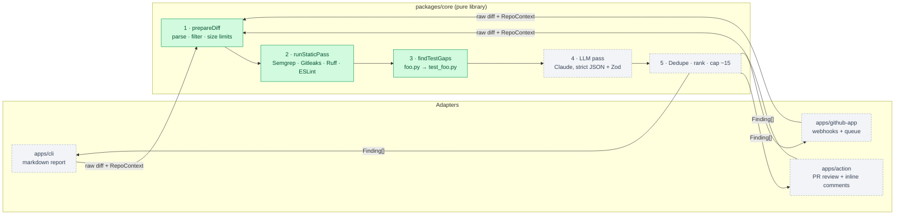
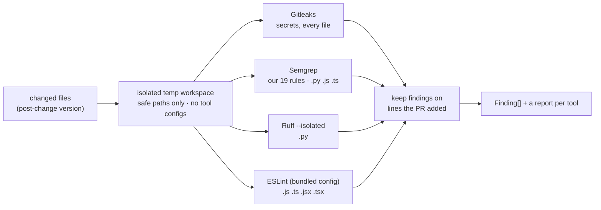

# PR Mentor

An AI code-review assistant for student repositories. It reviews pull requests for
**security issues**, **missing tests** and **code quality**, and every comment is written to
teach: why the issue matters, a small fix, and a link to learn more. The tone is a helpful
senior developer, not a linter.

> **Status:** Milestones 1 and 2 of 6 are done (diff handling, static analysis and the
> missing-tests check). The LLM pass and the CLI arrive in Milestone 3. See the
> [roadmap](#roadmap).

## What a review comment looks like

> **🔴 Critical · Security: SQL query built with string formatting** (`app/routes.py:12`)
>
> This query glues `user_id` straight into the SQL text. If someone sends `1 OR 1=1` as their
> ID, the database runs their SQL instead of yours and could return every user's data.
> Parameterised queries keep data and code separate:
>
> ```python
> cursor.execute("SELECT * FROM users WHERE id = ?", (user_id,))
> ```
>
> Learn more: [OWASP: SQL Injection](https://owasp.org/www-community/attacks/SQL_Injection)

## Architecture

The core engine is a pure library: a diff and some repo context go in, a list of structured
findings comes out. It knows nothing about GitHub. Thin adapters (CLI, GitHub Action,
GitHub App) feed it diffs and publish the results.



Green boxes are built; grey dashed boxes are planned. Adapters supply a `RepoContext`
(`readFile(path)` and optionally `listFiles()`) so core can read the post-change code without
knowing whether it comes from a working tree, a checkout, the GitHub API or eval fixtures.

### Step 1: `prepareDiff`

- **Parse** git or plain unified diffs into files and hunks, with old/new line numbers for
  every line. Hunks are read by the counts in their `@@` header, so content such as a removed
  SQL comment (`--- note`) can never be mistaken for a file header.
- **Filter** out what a student didn't write or can't act on: lockfiles, generated files
  (minified bundles, `dist/`, protobuf output, files marked `@generated`), vendored code
  (`vendor/`, `node_modules/`, virtualenvs), binaries and deleted files. Each skipped file
  keeps a reason so the report can say what was left out.
- **Size limits**, counted after filtering: 100 files, 3,000 changed lines and 5 MB of raw
  input by default. Over the limit, the review is skipped with a friendly message suggesting
  smaller PRs.

### Step 2: `runStaticPass`

Cheap, deterministic checks run before the LLM sees anything.



| Tool     | What it catches                                                                                                                                                                        | How it runs                                                                                                     |
| -------- | -------------------------------------------------------------------------------------------------------------------------------------------------------------------------------------- | --------------------------------------------------------------------------------------------------------------- |
| Gitleaks | Hardcoded keys, tokens and passwords (including committed `.env` files)                                                                                                                | `gitleaks dir` on the workspace; the raw secret never leaves the parser                                         |
| Semgrep  | [Our own rules](packages/core/rules/semgrep): SQL/command injection, `eval`, unsafe deserialization, XSS, Flask debug, TLS off, weak password hashes, JWT secrets, routes without auth | `--metrics=off`, local rules only, so results don't change between runs                                         |
| Ruff     | Bugs (undefined names), bandit security checks, swallowed exceptions, mutable defaults, giant/complex functions, dead code                                                             | `--isolated` and `--ignore-noqa`: a repo's config or `# noqa` can't silence it                                  |
| ESLint   | `eval`, empty `catch` blocks, unused variables, unreachable code, complexity, long functions, `==`                                                                                     | Node API with **our** config; the student's `eslint.config.js` is never loaded (it would be running their code) |

- Every common rule comes with a short teaching explanation, a fix snippet and a link
  (OWASP or the tool's docs).
- Tools run in parallel with a per-tool timeout. A missing tool is **skipped with an install
  hint**, a crashing one is reported as **failed**, and neither stops the others.
- Only findings on **lines the PR added** are kept: we review the change, not code that was
  already there, and GitHub can only comment on lines in the diff.

### Step 3: `findTestGaps`

Flags source files that gain new functions (or a meaningful chunk of code) in a PR with no
matching test change.

- A source file is matched to its tests across folders and naming styles: `payments.py` ↔
  `tests/test_payments.py`, `price.ts` ↔ `__tests__/price.test.ts`, `Price.java` ↔
  `PriceTest.java`, `user-service.ts` ↔ `userService.test.ts`.
- It also counts as covered when any changed test mentions one of the new functions.
- Docs, config, migrations, type declarations and trivial edits (comments, imports, a couple
  of lines) are ignored.
- The comment names the new functions, says which edge cases to try, points at an existing
  test file if there is one, and suggests a pytest or `describe`/`it` skeleton.

### The `Finding` schema

Every finding, whatever produced it, is validated against one Zod schema
([`finding.ts`](packages/core/src/finding.ts)):

| Field                       | Type                                                        |
| --------------------------- | ----------------------------------------------------------- |
| `file`, `line`, `endLine?`  | repo path; 1-based line numbers on the new side of the diff |
| `category`                  | `security` · `tests` · `quality`                            |
| `severity`                  | `critical` · `high` · `medium` · `low`                      |
| `title`                     | short summary, at most 120 characters                       |
| `explanation`, `suggestion` | why it matters (for a student) and a small fix (Markdown)   |
| `references`                | `{ title, url }[]`, **https only**                          |
| `confidence`                | 0 to 1                                                      |
| `source`                    | `semgrep` · `gitleaks` · `lint` · `heuristic` · `llm`       |
| `ruleId?`                   | the rule behind it, e.g. `ruff/S608`, for dedupe            |

## Setup

You need [pnpm](https://pnpm.io) 12 or newer. `pnpm install` downloads the pinned Node 22
runtime for this project (via `devEngines`), so your system Node version doesn't matter.

```sh
git clone https://github.com/Aswin-Times/Revolver-.git pr-mentor
cd pr-mentor
pnpm install
pnpm test
```

### Static analysis tools (optional, recommended)

ESLint is bundled. Semgrep, Gitleaks and Ruff are external programs; each one is skipped
with a hint if it isn't installed.

```sh
uv tool install ruff          # or: pip install ruff
uv tool install semgrep       # or: pipx install semgrep
brew install gitleaks         # Windows: winget install Gitleaks.Gitleaks
```

`uv` puts tools in `~/.local/bin`; run `uv tool update-shell` once if that folder isn't on
your `PATH`. CI pins Ruff 0.17.6, Semgrep 1.186.0 and Gitleaks 8.30.1.

From Milestone 3 on, the LLM pass needs an Anthropic API key. Copy `.env.example` to `.env`
and fill it in. `.env` is git-ignored; never commit a key.

## Usage

Until the CLI lands in Milestone 3, the core library can be used directly:

```ts
import { readFile } from "node:fs/promises";
import { findTestGaps, prepareDiff, runStaticPass, type RepoContext } from "@pr-mentor/core";

const prepared = prepareDiff(rawDiff); // e.g. the output of `git diff main...HEAD`
if (prepared.status === "too_large") {
  console.log(prepared.message); // friendly "please split this PR" note
} else {
  const repo: RepoContext = {
    readFile: (path) => readFile(path, "utf8").catch(() => undefined),
  };
  const staticPass = await runStaticPass(prepared.files, repo);
  const testGaps = await findTestGaps(prepared.files, repo);

  for (const t of staticPass.tools) console.log(t.tool, t.status, t.detail ?? "");
  for (const f of [...staticPass.findings, ...testGaps]) {
    console.log(`${f.severity} ${f.file}:${f.line} ${f.title}`);
  }
}
```

`prepareDiff` throws `DiffParseError` if the input isn't a valid diff.

## Project layout

```
packages/core/            review engine (pure library, no GitHub code)
  src/finding.ts          Finding schema
  src/redact.ts           secret redaction for anything we display
  src/repo.ts             RepoContext: how adapters supply file contents
  src/diff/               parser, filters, prepareDiff
  src/static/             command runner, workspace, one wrapper per tool, runStaticPass
  src/test-gap/           file classification, new-function detection, findTestGaps
  rules/semgrep/          our Semgrep rules (*.yml) with annotated test cases next to them
  test/                   Vitest suites; fixtures are real git/tool output (sanitized)
apps/                     CLI, GitHub Action, GitHub App (coming in later milestones)
```

## Safety principles

- **Student code is never executed.** All analysis is static. Tools run on a copy of the
  changed files in a temp folder, never on the student's checkout, and the student's tool
  configs (including executable ESLint configs) are never loaded.
- **The diff is untrusted input.** File paths from it are validated before anything is
  written (no `..`, absolute paths or drive letters), tools are started without a shell, and
  model output (Milestone 3) is validated against the schema. Nothing in a diff can make the
  tool call other tools or fetch URLs.
- **Secrets are redacted** in anything we output: only a known prefix and the last 4
  characters are shown (`sk-ant-****wxyz`, `AKIA****MPLE`), and only when at least 12
  characters stay hidden.
- **Reviews are idempotent:** a new push never re-posts comments that already exist.
- **Costs are capped** with a per-PR token budget, and tokens and cost are logged per review.

## Development

```sh
pnpm test               # everything
pnpm test:unit          # fast unit tests (~2s); pnpm test:watch runs these on save
pnpm test:integration   # runs the real Semgrep, Gitleaks and Ruff (skipped if missing)
pnpm lint               # type-aware ESLint
pnpm typecheck
pnpm format             # Prettier
pnpm build
```

The core engine is built test-first, and each step is mutation-checked: we break the code on
purpose to make sure a test notices. CI installs the pinned tools and runs the integration
tests with `PR_MENTOR_REQUIRE_TOOLS=1`, so they can't be skipped there.

## Roadmap

- [x] **M1:** monorepo scaffold, finding schema, diff parser, filters and size limits
- [x] **M2:** static pass wrappers (Semgrep, Gitleaks, Ruff, ESLint) and the test-gap heuristic
- [ ] **M3:** LLM pass with schema validation and retries; CLI markdown report
- [ ] **M4:** eval harness with ~15 fixture PRs and precision/recall per category
- [ ] **M5:** GitHub Action with inline comments, summary and idempotency
- [ ] **M6:** GitHub App (webhooks, queue, Render deploy) and per-repo `.prmentor.yml`
